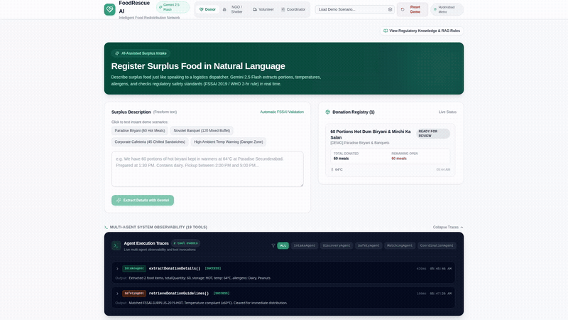
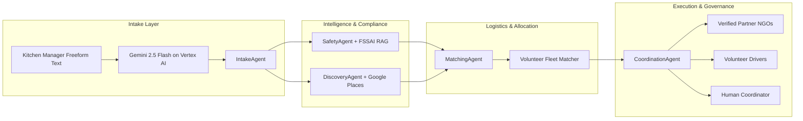

# 🥗 FoodRescue AI — Intelligent Food Redistribution Network

[](https://antigravity.google)
[](https://cloud.google.com/vertex-ai)
[](https://deepmind.google/technologies/gemini/)
[](https://nextjs.org/)
[](LICENSE)

> **Built for the Google Build with Gemini .** An autonomous multi-agent surplus food logistics network powered by **Google Gemini 2.5 Flash on Vertex AI**, enforcing FSSAI 2019 statutory regulations, WHO safety standards, and real-time fleet coordination.

---

## 📽️ Demo Video Walkthroughs

Two versions of the demonstration video with neural voiceover narration are available:

### ⚡ 1. Fast Pitch (60-Second Version) — A Quick Review for Judges
- 🎬 **Watch Inline on GitHub**: [**`public/foodrescue_ai_60s_demo.mp4`**](https://github.com/rohit-0604/buildwithgemini-foodrescue-ai/blob/main/public/foodrescue_ai_60s_demo.mp4)
- 💾 **Direct Download (4.3 MB)**: [**Download 60s MP4**](https://github.com/rohit-0604/buildwithgemini-foodrescue-ai/releases/download/v1.1.0/foodrescue_ai_60s_demo.mp4) *(or [Raw CDN Mirror](https://raw.githubusercontent.com/rohit-0604/buildwithgemini-foodrescue-ai/main/public/foodrescue_ai_60s_demo.mp4))*
- 📦 **GitHub Release Asset**: [**Release v1.1.0**](https://github.com/rohit-0604/buildwithgemini-foodrescue-ai/releases/tag/v1.1.0)
- ⚙️ **Specs**: 1080p Full HD Progressive (25 FPS, FastStart Web-Optimized, AAC Audio, 53.7s)

<p align="center">
  <a href="https://github.com/rohit-0604/buildwithgemini-foodrescue-ai/blob/main/public/foodrescue_ai_60s_demo.mp4">
    
  </a>
</p>
<p align="center"><em>👆 Live automated multi-agent intake & extraction. Click animation above or link to watch 1080p video with audio.</em></p>

### 🔍 2. Full Architecture & Multi-Agent Deep Dive (2m 32s)
- 🎬 **Watch Inline on GitHub**: [**`public/foodrescue_ai_demo.mp4`**](https://github.com/rohit-0604/buildwithgemini-foodrescue-ai/blob/main/public/foodrescue_ai_demo.mp4)
- 💾 **Direct Download (11.4 MB)**: [**Download Full MP4**](https://github.com/rohit-0604/buildwithgemini-foodrescue-ai/releases/download/v1.0.0/foodrescue_ai_demo.mp4) *(or [Raw CDN Mirror](https://raw.githubusercontent.com/rohit-0604/buildwithgemini-foodrescue-ai/main/public/foodrescue_ai_demo.mp4))*
- 📦 **GitHub Release Asset**: [**Release v1.0.0**](https://github.com/rohit-0604/buildwithgemini-foodrescue-ai/releases/tag/v1.0.0)
- ⚙️ **Specs**: 1080p Full HD Progressive (25 FPS, FastStart Web-Optimized, AAC Audio, 2m 32s)

---

## 💡 The Problem

Every day, hotels, banquet halls, restaurants, corporate campuses, and weddings produce hundreds of kilograms of wholesome, edible surplus food. Simultaneously, millions face acute food insecurity.

Connecting surplus food to recipient organizations is operationally challenging:
1. **Time Sensitivity**: Hot cooked food deteriorates rapidly; ambient heat accelerates bacterial germination.
2. **High-Friction Intake**: Exhausted commercial kitchen staff cannot fill complex 30-field forms.
3. **Food Safety & Legal Liability**: Donors fear liability; statutory holding guidelines (FSSAI 2019) are rarely automated.
4. **Logistics Mismatch**: Vehicles lack thermal insulation; volunteers experience sudden drop-offs and flat tires.
5. **Shelter Over-Saturation**: Donating 150 meals to a 40-capacity shelter causes immediate spoilage.

---

## 🚀 The Solution: FoodRescue AI

FoodRescue AI solves this through an orchestrated mesh of **5 specialized autonomous AI agents**, **19 discrete operational tools**, an **authoritative RAG safety knowledge engine**, and a **human-in-the-loop coordination dashboard**.



---

## 🤖 Multi-Agent Architecture

| Agent | Core Responsibility | Key Invocations | Guardrails & Safety Fallback |
| :--- | :--- | :--- | :--- |
| **`IntakeAgent`** | Converts freeform conversational text into structured meal entities with strict typing. | `parseDonationText`, `checkDonationReadiness` | Validates portion counts, holding temperatures, and missing critical fields. |
| **`SafetyAgent`** | Evaluates bacterial danger zones, Hyderabad summer climate heat directives, and statutory regulations. | `retrieveDonationGuidelines`, `verifyHoldingTemperature`, `logSafetyIncident` | **Blocks automated dispatch** if food held between 5°C and 60°C for > 2 hours or ambient duration > 3.5 hrs. Mandatory human coordinator review. |
| **`DiscoveryAgent`** | Finds recipient kitchens, shelters, and food banks within feasible delivery radiuses. | `findNearbyRecipients`, `discoverPlacesLeads` | Differentiates **Verified Partner NGOs** from unverified **Google Places Leads**. |
| **`MatchingAgent`** | Computes non-over-allocating meal distributions and vehicle thermal compatibility. | `calculateAllocationPlan`, `rankVolunteerMatches`, `checkVehicleCapacity` | Strictly preserves unallocated portions; matches hot food exclusively with insulated containers. |
| **`CoordinationAgent`**| Superintends state machine, dispatches push proposals, and executes real-time replanning upon cancellations. | `requestRecipientAcceptance`, `assignVolunteerTransport`, `replanMission`, `summarizeCoordinationState` | Generates real-time natural language situation summaries for human coordinators. |

---

## 🛠️ The 19 Executable Tools Catalog

Every tool is strictly typed, mutates the atomic database, and records an `AgentExecutionTrace`:
1. `parseDonationText` — Structured extraction with Gemini 2.5 Flash
2. `checkDonationReadiness` — Validates donation completeness
3. `retrieveDonationGuidelines` — Queries RAG safety database
4. `verifyHoldingTemperature` — Checks hot ($\ge 60^\circ\text{C}$) and cold ($\le 5^\circ\text{C}$) thresholds
5. `findNearbyRecipients` — Radius-based verified partner lookup
6. `discoverPlacesLeads` — Discovers community kitchen leads
7. `verifyRecipientCapacity` — Enforces recipient meal caps
8. `calculateAllocationPlan` — Capacity-aware multi-recipient splitter
9. `requestRecipientAcceptance` — Pushes proposals to recipient shelters
10. `recordRecipientResponse` — Logs acceptance, partial acceptance, or rejection
11. `findAvailableVolunteers` — Queries nearby volunteer fleet
12. `checkVehicleCapacity` — Validates cargo capacity and thermal specs
13. `rankVolunteerMatches` — Ranks drivers by distance and equipment
14. `assignVolunteerTransport` — Reserves driver for pickup
15. `updateTransportStatus` — Handles pickup temp check and transit
16. `confirmDeliveryHandoff` — Confirms physical recipient handover
17. `replanMission` — Dynamic replanning upon shelter rejections or vehicle breakdowns
18. `summarizeCoordinationState` — Synthesizes natural language status reports
19. `logSafetyIncident` — Immutable audit logging for regulatory non-compliance

---

## 📜 Regulatory Knowledge Base (RAG)

Embedded statutory and scientific standards:
- **FSSAI Surplus Food Recovery Regulations (2019, Section 4.2)**: Hot holding $\ge 60^\circ\text{C}$, cold storage $\le 5^\circ\text{C}$.
- **WHO 2-Hour / 4-Hour Rule**: Food in the 5°C–60°C microbial danger zone must be distributed within 2 hours or safely destroyed.
- **Hyderabad Municipal Public Health Directive**: In ambient temperatures $>32^\circ\text{C}$, spoilage in cooked rice and gravies accelerates by 300%; transit capped at 90 minutes.
- **Section 357A CrPC & Good Samaritan Protection**: Legal immunity for bona fide food donors and non-profit logistics volunteers.

---

## 🖥️ Four Interactive Role Views

1. **Donor View**: Natural language surplus intake box with quick sample buttons, live Gemini extraction preview, FSSAI compliance badges, and active donation tracker.
2. **NGO / Recipient View**: Recipient portal with organization switcher, incoming proposals, and an interactive quantity slider for partial or full acceptance.
3. **Volunteer Fleet View**: Driver profile switcher, vehicle capacity verification, physical pickup with temperature logging ($64^\circ\text{C}$), delivery confirmation, and breakdown simulation.
4. **Coordinator Command Center**: Central mission control with KPI cards, mission inspector, human-in-the-loop approval button, manual replanning button, regulatory standards inspector, and an immutable event audit stream.

---

## ⚡ Quick Start & Local Run

### Prerequisites
- Node.js 18+ or 20+
- Google Cloud Project with Vertex AI API enabled (or standard Gemini API Key)

### Installation
```bash
# Clone the repository
git clone https://github.com/rohit-0604/foodrescue-ai.git
cd foodrescue-ai

# Install dependencies
npm install

# Configure environment variables
cp .env.example .env.local
# Set GOOGLE_CLOUD_PROJECT=your-project-id
```

### Running the App
```bash
# Start Next.js development server
npm run dev

# Or start production server
npm run build
npm run start
```
Open **`http://localhost:8080`** in your browser.

### Running Acceptance Tests
```bash
npm run test:acceptance
```
All 7 core acceptance criteria tests run end-to-end and pass cleanly!

---

## 🗺️ Documentation Links

- [System Architecture](docs/ARCHITECTURE.md)
- [Hackathon Demo Presentation Script](docs/DEMO_SCRIPT.md)
- [Production Engineering Roadmap](docs/ROADMAP.md)

---

## 📄 License
This project is licensed under the MIT License.
