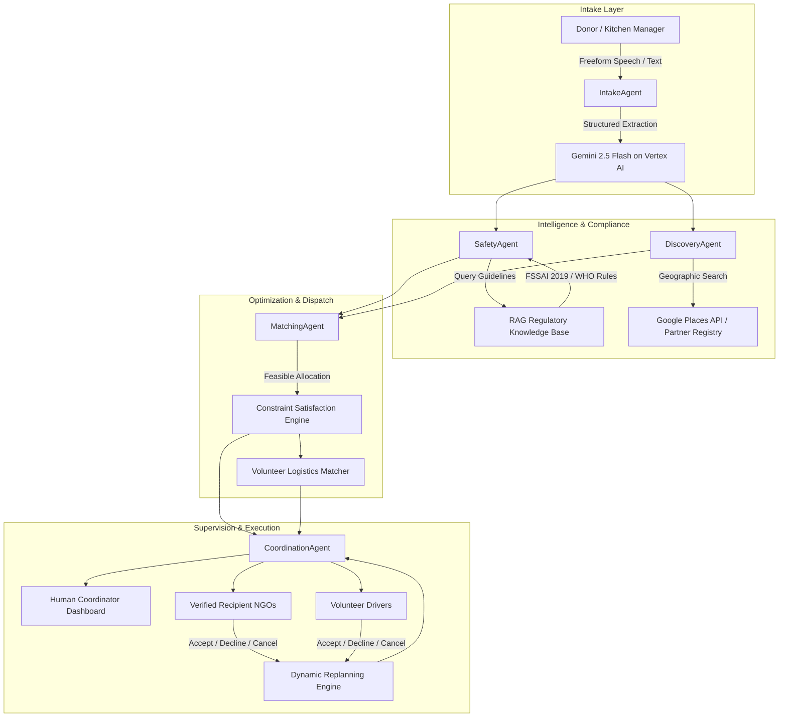

# FoodRescue AI — System Architecture & Technical Design

## 1. Executive Summary

**FoodRescue AI** is an autonomous, multi-agent logistics network engineered to solve the operational crisis in surplus food redistribution. When commercial banquets, wedding halls, tech campuses, and restaurants generate large quantities of wholesome food, traditional matching fails due to:
- Time sensitivity (hot food cools; perishable gravies enter the microbial danger zone)
- Unstructured intake (exhausted kitchen managers cannot fill 30-field forms)
- Safety and liability hesitation
- Vehicle capacity and thermal mismatch
- Unpredictable volunteer attrition and recipient kitchen capacity

FoodRescue AI addresses these challenges through an orchestrated mesh of **five specialized AI agents**, **nineteen discrete operational tools**, an **authoritative RAG safety knowledge base** (citing FSSAI 2019 regulations and WHO guidelines), and a **human-in-the-loop coordination dashboard**.

---

## 2. Multi-Agent System Topology



---

## 3. Specialized Agent Roles

| Agent | Responsibility | Key Invocations | Fallback & Guardrails |
| :--- | :--- | :--- | :--- |
| **IntakeAgent** | Extracts food items, portion quantities, allergens, holding temperatures, and pickup windows from conversational text. | `parseDonationText`, `checkDonationReadiness` | Deterministic regex / token extraction when LLM latency spikes or API token rate limits trigger. |
| **SafetyAgent** | Evaluates bacterial danger zones, Hyderabad summer climate acceleration, allergen cross-contamination, and statutory compliance. | `retrieveDonationGuidelines`, `verifyHoldingTemperature`, `logSafetyIncident` | Blocks automated dispatch and flags `requiresHumanReview: true` if temperatures fall between 5°C and 60°C or ambient duration > 2 hours. |
| **DiscoveryAgent** | Discovers community kitchens, shelters, and food banks within feasible delivery radiuses. | `findNearbyRecipients`, `discoverPlacesLeads` | Differentiates registered `Verified Partner NGOs` from unverified `Google Places Leads`. |
| **MatchingAgent** | Computes allocation splits that prevent recipient over-saturation while honoring vehicle thermal capacity. | `calculateAllocationPlan`, `rankVolunteerMatches`, `checkVehicleCapacity` | Strictly preserves unallocated portions; never over-allocates beyond declared recipient intake capacity. |
| **CoordinationAgent** | Manages multi-turn state transitions, sends push proposals to NGOs/volunteers, and executes real-time replanning upon cancellations. | `requestRecipientAcceptance`, `assignVolunteerTransport`, `replanMission`, `summarizeCoordinationState` | Synthesizes Gemini natural language situation reports for human coordinators. |

---

## 4. The 19 Executable Tools Catalog

FoodRescue AI features a strongly-typed tool library with structured inputs, deterministic outputs, atomic persistence mutations, and automatic execution trace logging:

```typescript
1. parseDonationText(text, donorId?)
2. checkDonationReadiness(donationId)
3. retrieveDonationGuidelines(storageCondition, temp, duration, allergens)
4. verifyHoldingTemperature(temperatureCelsius, storageCondition)
5. findNearbyRecipients(donationId, radiusKm, maxResults)
6. discoverPlacesLeads(lat, lng, query, radiusKm)
7. verifyRecipientCapacity(recipientId, requestedQuantity)
8. calculateAllocationPlan(donationId, recipientIds)
9. requestRecipientAcceptance(missionId, recipientId, quantity)
10. recordRecipientResponse(responseId, status, acceptedQuantity, notes)
11. findAvailableVolunteers(pickupLocation, radiusKm, maxVolunteers)
12. checkVehicleCapacity(volunteerId, mealQuantity, storageType)
13. rankVolunteerMatches(missionId, candidateVolunteerIds)
14. assignVolunteerTransport(missionId, volunteerId)
15. updateTransportStatus(assignmentId, status, notes)
16. confirmDeliveryHandoff(assignmentId, verifiedQuantity, notes)
17. replanMission(missionId, triggerReason)
18. summarizeCoordinationState(missionId)
19. logSafetyIncident(donationId, violationType, severity, description)
```

---

## 5. Food Safety Knowledge Base (RAG Engine)

The safety engine embeds statutory and scientific standards:

1. **FSSAI Food Safety and Standards (Recovery & Distribution of Surplus Food) Regulations, 2019 (Section 4.2)**:
   - Hot food must be held at or above **60°C**.
   - Cold food must be held at or below **5°C**.
   - If food temperature enters the danger zone, it must be distributed within **2 hours** or destroyed.
2. **WHO 2-Hour / 4-Hour Rule**:
   - Food between 5°C and 60°C for < 2 hours can be safely redistributed immediately.
   - Food between 2 and 4 hours must be consumed immediately and cannot be re-chilled.
   - Food > 4 hours in the danger zone is biohazardous and strictly discarded.
3. **Hyderabad Municipal Public Health — Ambient Food Spoilage Protocol**:
   - In Telangana ambient heat (>32°C), bacterial spore germination in gravies and biryani accelerates by 300%. Transit windows are capped at **90 minutes** unless temperature logging is verified.
4. **Section 357A CrPC & Good Samaritan Surplus Food Protection**:
   - Indemnifies donors and volunteer transporters from civil and criminal liability when adhering to verified hygiene guidelines in good faith.
5. **FSSAI Mandatory Allergen Labeling Standards**:
   - Mandates explicit declarations for Dairy, Peanuts, Tree Nuts, Gluten, Soy, and Shellfish.

---

## 6. Persistence & Observability Architecture

- **Atomic File Store**: Database state is serialized to `.data/foodrescue_db.json` with transactional locking and deep cloning to eliminate race conditions.
- **Agent Execution Traces**: Every tool execution records an `AgentExecutionTrace` capturing agent role, tool called, start/end timestamps, execution duration in milliseconds, input parameters, execution status (`SUCCESS`, `BLOCKED`, `FAILURE`), and next recommended action.
- **Audit Event Log**: All missions maintain an append-only `MissionEvent` stream recording interactions from Donors, NGOs, Volunteers, Coordinators, and autonomous Agents.
